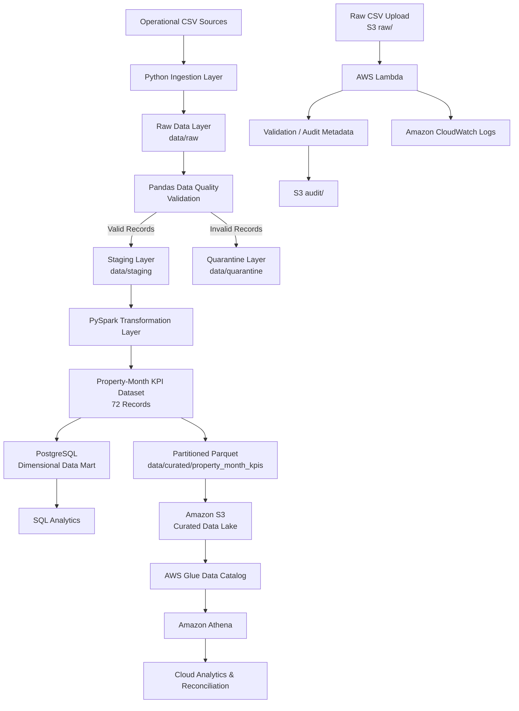
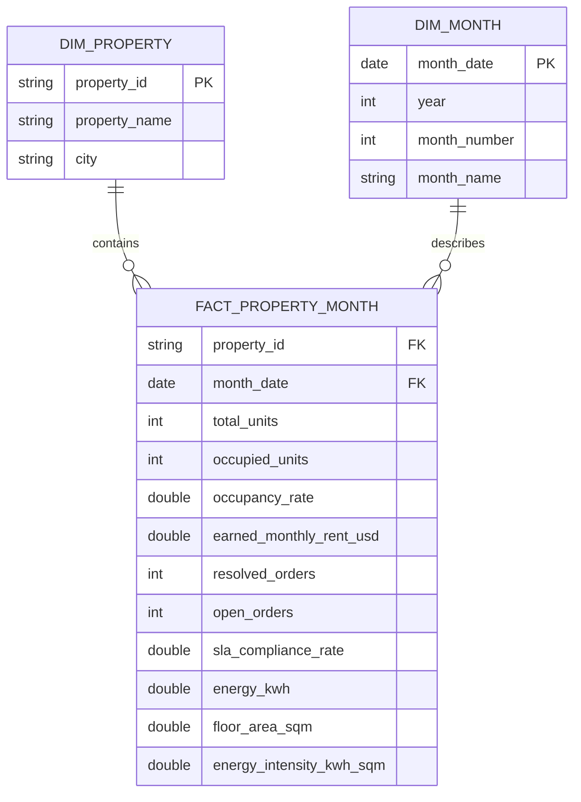

# PropTech360 — End-to-End Data Engineering Capstone

An end-to-end data engineering solution for a fictional property management company, **PropTech360**, covering data ingestion, validation, transformation, analytics engineering, dimensional modelling, cloud storage, serverless processing, and SQL analytics.

The project demonstrates how raw operational property data can be transformed into reliable, analytics-ready property-month KPIs using **Python, Pandas, PySpark, PostgreSQL, Amazon S3, AWS Lambda, AWS Glue Data Catalog, Amazon Athena, IAM, and CloudWatch**.

---

## Project Overview

PropTech360 manages multiple properties and collects operational data relating to:

- Properties
- Rental units
- Lease agreements
- Maintenance work orders
- Energy meter readings

The objective of this project was to design and implement a reproducible data platform capable of validating these datasets, isolating bad records, producing property-level monthly KPIs, storing analytical results in PostgreSQL and AWS, and making the curated data available for SQL-based analysis.

The reporting period covers:

**January 2026 — June 2026**

The final curated dataset contains:

- **12 properties**
- **6 reporting months**
- **72 unique property-month records**

---

# Business Problem

Property management organisations typically operate across multiple systems containing lease, maintenance, building, and energy data.

Without a reliable data pipeline, these datasets may contain:

- Duplicate records
- Invalid identifiers
- Broken foreign-key relationships
- Missing values
- Invalid dates
- Negative financial or energy values
- Overlapping leases
- Invalid categorical values
- Out-of-period readings

These issues can lead to inaccurate occupancy, revenue, maintenance, and energy reporting.

PropTech360 therefore requires a data platform that can:

1. Ingest operational datasets safely.
2. Validate and quarantine bad records.
3. Produce trustworthy monthly property KPIs.
4. Support analytical SQL queries.
5. Store curated data efficiently.
6. Extend the pipeline into a serverless AWS data lake.

---

# Solution Architecture



---

# Data Pipeline Architecture

The project follows a layered architecture:

```text
Operational CSV Files
        |
        v
Python Ingestion
        |
        v
Raw Layer
data/raw/
        |
        v
Pandas Validation
       / \
      /   \
     v     v
Staging   Quarantine
     |
     v
PySpark Transformations
     |
     v
Property-Month KPIs
     |
     +--------------------+
     |                    |
     v                    v
PostgreSQL          Partitioned Parquet
Data Mart           Local Curated Layer
                          |
                          v
                      Amazon S3
                          |
                          v
                 AWS Glue Data Catalog
                          |
                          v
                    Amazon Athena
```

---

# Technology Stack

| Category | Technologies |
|---|---|
| Programming | Python |
| Data Processing | Pandas, PySpark |
| Distributed Processing | Apache Spark |
| Database | PostgreSQL |
| Python/PostgreSQL Driver | psycopg |
| Data Format | CSV, Parquet, JSON |
| Local Analytics | SQL |
| Cloud Storage | Amazon S3 |
| Serverless Compute | AWS Lambda |
| Metadata Catalog | AWS Glue Data Catalog |
| Cloud Analytics | Amazon Athena |
| Monitoring | Amazon CloudWatch |
| Security | AWS IAM |
| Development | VS Code, Jupyter Notebook |
| Version Control | Git, GitHub |

---

# Project Workflow

## 1. Python Ingestion and Reproducibility

The first stage implements controlled ingestion of the five source datasets:

```text
properties.csv
units.csv
leases.csv
work_orders.csv
meter_readings.csv
```

The ingestion process verifies:

- File existence
- Required columns
- Non-empty datasets
- Row counts
- File metadata
- SHA-256 hashes
- UTC ingestion timestamps

An ingestion manifest is generated to provide traceability and reproducibility.

---

## 2. Data Validation and Quarantine

Pandas is used to profile and validate the raw datasets before downstream processing.

Validation checks include:

- Null values
- Duplicate identifiers
- Exact duplicate rows
- Invalid foreign keys
- Invalid categorical values
- Negative costs
- Negative energy readings
- Invalid lease dates
- Invalid work-order chronology
- Missing response durations
- Invalid reporting months
- Duplicate unit/month meter readings
- Overlapping lease periods

Invalid records are isolated in:

```text
data/quarantine/
```

Valid records are written to:

```text
data/staging/
```

This prevents known bad records from contaminating downstream analytics.

---

# Automated Data Quality Tests

Automated assertions are included to verify important pipeline assumptions.

Tests cover areas such as:

- Duplicate identifiers
- Foreign-key integrity
- Date validity
- Invalid numeric values
- Category validation
- Lease overlaps
- Property-month uniqueness

The data quality stage must pass before curated transformation continues.

---

# PySpark Transformation Layer

Validated staging datasets are processed using PySpark.

The transformation process creates a reporting spine of:

```text
12 properties × 6 months = 72 property-month records
```

The six reporting month-end dates are:

```text
2026-01-31
2026-02-28
2026-03-31
2026-04-30
2026-05-31
2026-06-30
```

The Spark pipeline independently aggregates:

- Unit availability
- Lease occupancy
- Earned monthly rent
- Maintenance activity
- SLA compliance
- Energy consumption
- Property floor area

These aggregates are then joined at the common grain:

```text
(property_id, month)
```

This approach prevents duplicate multiplication when combining fact datasets.

---

# Final Property-Month KPIs

The curated dataset contains metrics including:

| Metric | Description |
|---|---|
| `property_id` | Unique property identifier |
| `month` | Reporting month end |
| `total_units` | Number of active units |
| `occupied_units` | Units occupied at month end |
| `occupancy_rate` | Occupied units / total units |
| `earned_monthly_rent_usd` | Contractual monthly rent earned |
| `resolved_orders` | Resolved maintenance work orders |
| `sla_eligible_orders` | Resolved orders eligible for SLA measurement |
| `sla_compliant_orders` | Eligible orders satisfying SLA requirements |
| `open_orders` | Unresolved work orders |
| `sla_compliance_rate` | SLA-compliant / SLA-eligible orders |
| `energy_kwh` | Property energy consumption |
| `floor_area_sqm` | Total active floor area |
| `energy_intensity_kwh_sqm` | Energy consumed per square metre |

---

# Partitioned Parquet Output

The final dataset is stored as partitioned Parquet:

```text
data/curated/property_month_kpis/
│
├── month=2026-01-31/
├── month=2026-02-28/
├── month=2026-03-31/
├── month=2026-04-30/
├── month=2026-05-31/
└── month=2026-06-30/
```

Partitioning by month improves analytical query efficiency and enables partition pruning in engines such as Amazon Athena.

---

# PostgreSQL Dimensional Data Mart

A PostgreSQL dimensional model was created to support structured analytics.

The model consists of:

```text
dim_property
dim_month
fact_property_month
```

Conceptually:



---

# Idempotent PostgreSQL Loading

The fact dataset is loaded into PostgreSQL using an idempotent upsert strategy:

```sql
INSERT ...
ON CONFLICT (property_id, month_date)
DO UPDATE ...
```

This ensures repeated pipeline executions update existing property-month records instead of creating duplicates.

The loader was executed more than once and the fact table remained:

```text
72 rows
```

confirming idempotent behaviour.

---

# PostgreSQL Analytics

Five analytical SQL exercises were implemented.

They include:

1. Ranking properties by average monthly occupancy.
2. Calculating earned contractual rent by city.
3. Measuring maintenance SLA compliance.
4. Identifying property-months with energy intensity above portfolio averages.
5. Building a portfolio-level dashboard view.

These queries demonstrate analytical use of the dimensional data mart.

---

# AWS Serverless Data Lake

The curated local data pipeline was extended to AWS.

The cloud architecture uses:

```text
Amazon S3
    +
AWS Lambda
    +
AWS IAM
    +
Amazon CloudWatch
    +
AWS Glue Data Catalog
    +
Amazon Athena
```

The AWS resources were deployed in:

```text
us-east-1
```

---

# Amazon S3 Data Lake

The S3 bucket uses the following logical structure:

```text
proptech360-project/
│
├── raw/
│   └── properties.csv
│
├── curated/
│   └── property_month_kpis/
│       ├── month=2026-01-31/
│       ├── month=2026-02-28/
│       ├── month=2026-03-31/
│       ├── month=2026-04-30/
│       ├── month=2026-05-31/
│       └── month=2026-06-30/
│
├── audit/
│   └── properties_audit.json
│
└── athena-results/
```

The S3 bucket remains private and uses AWS-managed server-side encryption.

---

# AWS Lambda Raw Data Audit

A Python Lambda function named:

```text
proptech360-raw-audit
```

is triggered when new files arrive under:

```text
raw/
```

The function validates relevant S3 event information and captures metadata including:

- Bucket name
- Object key
- File size
- ETag
- Event information
- Processing timestamp

It writes an audit JSON object to:

```text
audit/
```

Example:

```text
audit/properties_audit.json
```

Restricting the event trigger to the `raw/` prefix prevents audit-file writes from recursively triggering the Lambda.

---

# IAM and Security

The Lambda execution role follows a least-privilege approach.

The function requires permission only for the relevant resources, including:

```text
S3 raw objects        -> Read
S3 audit prefix       -> Write
CloudWatch Logs       -> Write
```

The Lambda is not granted unrestricted write access across all S3 buckets.

Other security controls include:

- Private S3 bucket
- Block Public Access enabled
- Server-side encryption
- Prefix-scoped Lambda trigger
- Environment secrets excluded from source control

---

# CloudWatch Monitoring

AWS Lambda execution is monitored through Amazon CloudWatch.

The logs confirm:

- S3 event received
- Correct source bucket
- Correct `raw/` key
- Object size captured
- ETag captured
- Audit object created successfully

This provides operational observability and evidence of the serverless workflow.

---

# AWS Glue and Amazon Athena

The curated Parquet dataset is registered in the AWS Glue Data Catalog and queried through Amazon Athena.

Athena confirmed the expected dataset grain:

```text
Total rows:                 72
Unique property-months:     72
Properties:                 12
Months:                      6
```

This reconciles the cloud dataset with the local PySpark output.

---

# Athena Analytics

Athena was used to perform serverless analytical queries including:

- Property occupancy analysis
- Monthly rent analysis
- Energy consumption analysis
- Monthly portfolio aggregation
- Partition-filtered queries
- Property-month uniqueness validation

Because the dataset is partitioned by month, Athena can restrict scans to relevant partitions when month filters are applied.

---

# Data Quality Reconciliation

The project validates the same analytical grain across multiple processing layers:

```text
PySpark
   |
   v
72 property-month rows
   |
   v
PostgreSQL
   |
   v
72 property-month rows
   |
   v
Amazon Athena
   |
   v
72 property-month rows
```

This reconciliation demonstrates that the dataset remains consistent as it moves between processing and storage technologies.

---

# Project Structure

```text
proptech360-project/
│
├── data/
│   ├── raw/
│   ├── staging/
│   ├── quarantine/
│   └── curated/
│       └── property_month_kpis/
│
├── docs/
│
├── notebook/
│   └── PropTech_360_Data_Engineering_Capstone.ipynb
│
├── screenshots/
│
├── sql/
│   ├── schema.sql
│   └── 03_analytics.sql
│
├── src/
│
├── tests/
│
├── .env
├── .gitignore
├── README.md
└── requirements.txt
```

> `.env` contains local database credentials and must never be committed to source control.

---

# Environment Configuration

Create a `.env` file in the project root:

```env
PG_HOST=localhost
PG_PORT=5432
PG_DATABASE=proptech360
PG_USER=postgres
PG_PASSWORD=your_password
```

The `.gitignore` includes:

```gitignore
.env
.env.*
!.env.example

venv/
__pycache__/
*.pyc
.pytest_cache/
.ipynb_checkpoints/
.vscode/
```

---

# Local Setup

Clone the repository and enter the project:

```bash
git clone <repository-url>
cd proptech360-project
```

Create a virtual environment:

```bash
python -m venv venv
```

Activate it on Windows:

```bash
venv\Scripts\activate
```

Install dependencies:

```bash
python -m pip install -r requirements.txt
```

Launch Jupyter or open the project notebook through VS Code.

---

# Validation Evidence

Evidence captured during implementation includes:

```text
01-S3-bucket-structure
02-curated-partitions
03-athena-sql-query
04-proptech360-raw-audit-lambda
05-audit-folder
06-aws-cloud-watch-logs
```

Additional validation evidence can include:

```text
07-athena-row-count-validation
08-lambda-s3-trigger
09-lambda-iam-policy
10-idempotent-retry-validation
```

Screenshots are maintained under:

```text
screenshots/
```

---

# Key Engineering Concepts Demonstrated

This project demonstrates practical application of:

- Reproducible data ingestion
- File integrity validation
- Data profiling
- Data quality engineering
- Quarantine patterns
- Referential integrity
- Automated assertions
- Pandas transformations
- Distributed PySpark processing
- Dimensional modelling
- Fact and dimension tables
- Idempotent database loading
- PostgreSQL analytics
- Parquet optimisation
- Data partitioning
- Cloud data lakes
- Event-driven architecture
- Serverless computing
- Least-privilege IAM
- Cloud observability
- Data cataloguing
- Serverless SQL analytics
- Cross-platform reconciliation

---

# Key Results

The completed pipeline successfully:

- Ingested and validated five operational datasets.
- Detected and isolated invalid data.
- Tested duplicate and foreign-key integrity.
- Detected overlapping leases.
- Generated six monthly reporting periods.
- Produced exactly **72 property-month KPI records**.
- Created partitioned Parquet outputs.
- Built a PostgreSQL dimensional data mart.
- Implemented idempotent database loading.
- Completed five analytical PostgreSQL queries.
- Published curated Parquet data to Amazon S3.
- Registered and queried the dataset using AWS Glue and Athena.
- Implemented an event-driven Lambda audit workflow.
- Stored audit metadata in S3.
- Captured operational Lambda activity in CloudWatch.
- Reconciled local, PostgreSQL, and AWS analytical outputs.

---

# Future Improvements

Potential production extensions include:

- Apache Airflow orchestration
- Automated CI/CD pipeline testing
- Infrastructure as Code using Terraform or AWS CDK
- AWS Glue ETL jobs
- Amazon EventBridge orchestration
- Amazon QuickSight or Power BI dashboards
- Data quality frameworks such as Great Expectations
- Automated schema evolution
- S3 lifecycle policies
- CloudWatch alarms and alerting
- Centralised metadata and lineage tracking

---

# Conclusion

PropTech360 demonstrates the complete lifecycle of a modern data engineering solution: from raw operational files through validation, quarantine, distributed transformation, dimensional modelling, cloud storage, serverless processing, cataloguing, monitoring, and analytics.

The project combines local and cloud technologies while maintaining a consistent **property-month analytical grain**, demonstrating how data quality, scalability, reproducibility, security, and analytical usability can be incorporated into the same end-to-end data platform.

---

## Author

**Ayomikun Adaramola**

Senior Data Engineer | Cloud Data Engineering | AI & Data Platforms

Lagos, Nigeria

**GitHub:**  
https://github.com/ayomikunadaramola

**Portfolio:**  
https://ayomikun-adaramola.netlify.app